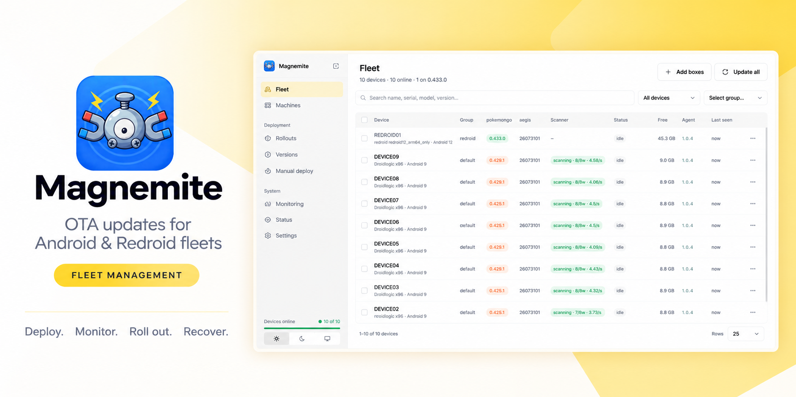

<div align="center">
  
  <h1>Magnemite</h1>
  <p><strong>Update, deploy and monitor a fleet of rooted Android devices or Redroid.</strong></p>
  <p>
    <strong>Update</strong>: watches for new Pokémon GO <code>.apkm</code> releases, caches
    each one once on your server, and rolls it out to one box, a group or the whole fleet, with
    canary rollouts, per-device progress, automatic retries and a hands-off mode.
  </p>
  <p>
    <strong>Deploy</strong>: brings boxes into the fleet from the dashboard. Rooted boxes are
    enrolled over adb, Redroid machines are provisioned from a bare VPS, and each scanner's MITM
    config is written onto every box in a group.
  </p>
  <p>
    <strong>Monitor</strong>: live status, memory, disk and temperature for every box, Rotom's
    view of each one, and rules that step in when a box stops scanning, with alerts on Discord,
    ntfy or the browser.
  </p>
  <p>
    Built for android devices and redroid running the Unown# stack.
  </p>
  
  <p>
    <a href="https://magnemite.chung-jf.me">
      
    </a>
  </p>
</div>

---

### Why “Magnemite”?

The scanning stack it plugs into names everything after Pokémon: Dragonite,
Golbat, Rotom, Koji, Poracle, so this one keeps the habit. Magnemite is the
magnet: it pulls new builds down once and sticks them onto every box. It is also
the Pokémon that only becomes interesting in numbers: three of them make a
Magneton, and this tool exists precisely because updating one box by hand is
fine and updating two hundred is not.

## Architecture

Monorepo (pnpm workspaces) plus a Go agent:

```
apps/
  hub/            Fastify server: device sockets, scheduler, rollouts, source pollers,
                  artifact cache, monitoring rules, Rotom sync
  web/            Next.js dashboard: fleet, machines, rollouts, monitoring, settings
  docs/           Documentation site (Fumadocs)
packages/
  db/             Prisma schema + client, shared by hub and web (Postgres or MySQL/MariaDB)
  protocol/       Wire protocol shared by hub and dashboard (mirrored in Go)
  apk/            Reads package name and version out of an APK or .apkm
agent/            Go agent: one binary for the boxes and for the machines that run Redroid
  magisk/         Magisk module that installs and launches the agent on a rooted box
  redroid/        Redroid image: Android in a container, with the agent started by init
  host/           Bootstrap that turns a bare arm64 VPS into a Redroid machine
  box/            Script that enrolls a hardware box over adb
scripts/          Builds, bulk enrollment and the fake fleet
data/             Local runtime data (cached APK artifacts, etc.)
deploy/           Docker Compose stacks, Caddy edge, Redroid compose, Grafana dashboards
```

Every box and every machine runs the same agent, and it dials **out** to the
hub over a persistent WebSocket: it enrolls with a token, sends a heartbeat with
its readings, and takes jobs, commands and config over that one socket, so
nothing on the LAN needs exposing. The Caddy edge serves the cached builds
straight off disk, so a fleet-wide rollout never streams through Node. The
dashboard reads the database directly and goes through the hub's internal API
for anything that touches a live socket. The full picture is in
[How this magnet works](https://magnemite.chung-jf.me/docs/architecture).

## Features & Services

### Update

- 📡 **Source feeds**: watches any index in the shared format for new Pokémon GO
  releases, on a schedule. Each `.apkm` is downloaded once, hashed and cached on
  the server.
- 🚀 **Rollouts**: target one box, a selection, a group or the whole fleet.
  Canary boxes go first and a failure parks the rollout instead of spreading it,
  with per-device progress (download, install phase, the box's own log),
  concurrency caps and automatic retries.
- ⚙️ **Hands-off mode**: new version → cached → rolled out inside your time
  window, with nobody watching.
- 📦 **Manual deploy**: upload an APK or `.apkm` and push it to the boxes you
  pick. The package name and version are read from the file itself.
- 🔄 **Agent self-update**: the agent on every box and machine keeps itself up
  to date.

### Deploy

- 📲 **Add boxes over adb**: scan a LAN from the dashboard, tick the rooted boxes
  you want, and each gets the agent, its own token and a reboot. The hub runs
  adb itself, or hands it to a machine on the boxes' LAN when it cannot reach
  them.
- 🐳 **Redroid**: a box can be Android in a Docker container instead of
  hardware, with the same agent, the same protocol and real installs. The image
  is the install, so there is no zip to flash.
- 🖥️ **Machines**: turn a bare arm64 VPS into a Redroid machine from one form
  and its SSH access. It enrolls like a box, reports its own load, memory, swap
  and disk, and scales its containers from the dashboard, showing each new
  instance from container to installed apps.
- 🧩 **MITM configs**: the config file Aegis, Atlas or GoCheats needs, set once
  per group with per-device placeholders and written onto every box in it.
- 📥 **Install on join**: the builds every box joining a group is given, before
  anybody asks.
- 🔑 **Enrollment tokens**: one shared secret that lets a factory-fresh box
  register itself and trade up for its own.

### Monitor

- 🗂️ **Fleet view**: every box at a glance, with installed versions, scanner
  state, free space, agent version and last seen, filtered by group or machine.
- 📊 **Load and metrics**: CPU, memory, storage, temperature and per-app usage,
  with history per box, plus Grafana dashboards that read the database directly.
- 🔮 **Rotom integration**: a Scanner column (scanning, stalled, idle, disabled)
  with workers and request rate, and restart, drop, reboot, enable and disable
  sent over Rotom's own connection, so they still work when the agent is dead.
- 🚨 **Monitoring rules** _(WIP, off by default)_: watch for a dead scanner
  service, the app out of focus, an ANR, a stalled loop, a silent or unreachable
  box, Rotom losing it, low memory, a full disk or heat, and on machines for
  docker or a container going down. Each rule climbs a ladder of actions, soft
  first, and alerts on Discord, ntfy or browser push. The **Monitoring** page
  keeps what they saw and did.
- 📶 **Connectivity history**: every stretch a box was out of contact, and
  whether the socket dropped or the heartbeats stopped.
- 📜 **Logs, shell and screenshots**: live logs, a full logcat `.zip`
  (collected automatically after an outage), a root shell, and a picture of
  what is on the screen.
- 🔧 **Maintenance windows**: park a box while you work on it. Nothing automatic
  touches it, a rollout aimed at it is refused, and the window closes by itself.

### Around it

- 🩺 **Status page**: hub, database, artifacts, feeds, Rotom and edge checked in
  one place, still answering from the database when the hub itself is down.
- 🧾 **Jobs, events & audit**: the history of every install and what happened on
  each box, plus an audit log of admin actions.
- 🔐 **Accounts**: dashboard login with sessions and roles.
- ⌨️ **Keyboard-first**: a command palette, `g` shortcuts to every page, and `?`
  for the full list.

## Acknowledgements

This tool exists because other people solved these problems first, on the same
hardware, and were generous enough to publish how.

- **[aconf](https://github.com/TechG3n/aconf)** by
  [@TechG3n](https://github.com/TechG3n) — the lineage of most of what
  Magnemite does per box. The MITM config paths and the per-device name
  substitution are its design, and the seeded monitoring rules are not
  invented: their thresholds and ladders are what its `atlas_monitor.sh` has
  been doing on this hardware for years.
- **[magisk-furtif](https://github.com/Furtif/magisk-furtif)** by
  [@Furtif](https://github.com/Furtif) — a per-box watchdog as a Magisk
  module: process checks, recovery, Discord alerts and Rotom health. It is
  where the low-memory rule comes from, and it answered the question of what a
  box should do about itself before a hub was holding the other end.
- **[Rotomina](https://github.com/f3ger/rotomina)** by
  [@f3ger](https://github.com/f3ger) — fleet management over ADB, with a
  per-device memory threshold and a per-device switch to stop touching a box.
  Magnemite's maintenance windows are that second idea with an expiry on it.

None of the three is a dependency, and all three are worth reading.
